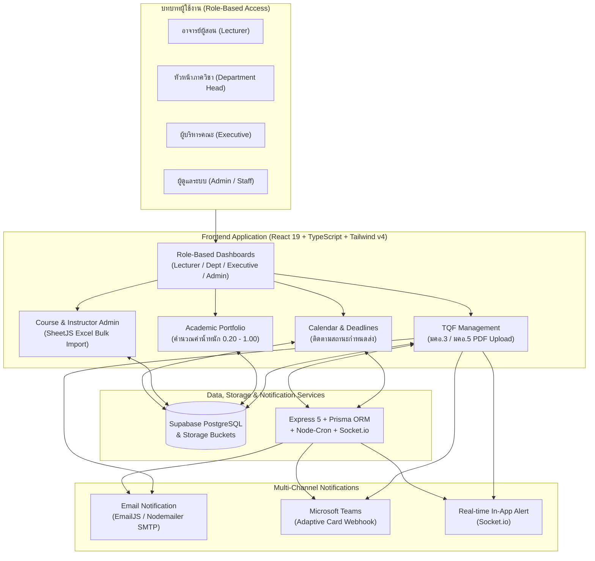

# QA Document Management System (SAR) — ระบบบริหารจัดการเอกสารประกันคุณภาพการศึกษาและแจ้งเตือนกำหนดส่งอัตโนมัติ

> **ประเภทโครงงาน:** โครงงานปริญญาตรี (Senior Project)  
> **ขอบเขตระบบ:** Full-Stack Web Application (React 19 + TypeScript + Tailwind CSS v4 + Supabase / Express 5 + Prisma ORM + MySQL + Multi-Channel Notification)

**QA Document Management System (SAR)** คือระบบเว็บแอปพลิเคชันสำหรับบริหารจัดการงานประกันคุณภาพการศึกษาภายในคณะและมหาวิทยาลัย ช่วยให้อาจารย์ หัวหน้าภาควิชา ผู้บริหาร และเจ้าหน้าที่สามารถจัดทำ อัปโหลด ส่งตรวจ และติดตามสถานะเอกสารมาตรฐานคุณวุฒิระดับอุดมศึกษา (**มคอ.3 / TQF3**, **มคอ.5 / TQF5**) รวมถึงบันทึกและคำนวณค่าน้ำหนัก **ผลงานทางวิชาการ (Academic Portfolio)** ได้ในที่เดียว พร้อมระบบแจ้งเตือนกำหนดส่งงานอัตโนมัติแบบหลายช่องทาง (**In-App Real-time Notification, Email และ Microsoft Teams Adaptive Card Webhook**)

---

## จุดเด่นของระบบ (Key Features)

- **ระบบแดชบอร์ดแยกตามบทบาทผู้ใช้งาน (Role-Based Dashboards)**:
  - **สำหรับผู้บริหาร (`ExecutiveDash`)**: แสดงภาพรวม KPI เฉลี่ยของคณะ สถานะการส่งเอกสาร มคอ.3 และ มคอ.5 แยกตามภาควิชา (เช่น คอมพิวเตอร์, ไฟฟ้า, โลจิสติกส์) กราฟแท่งเปรียบเทียบคะแนนผลงานทางวิชาการรายภาควิชา และการจัดอันดับอาจารย์ที่มีคะแนน KPI สูงสุด (**Top 5 Excellence**)
  - **สำหรับหัวหน้าภาควิชา (`DepartmentOverview`)**: ติดตามความคืบหน้าการส่งเอกสารและผลงานวิจัยของอาจารย์ภายในสาขาวิชา
  - **สำหรับอาจารย์ผู้สอน (`LecturerDash`)**: สรุปภาระงานสอน สถานะเอกสารที่ค้างส่ง และกำหนดการสำคัญที่ใกล้ถึงกำหนด
  - **สำหรับผู้ดูแลระบบ (`AdminDash`)**: จัดการข้อมูลหลักสูตร รายวิชา การลงทะเบียนอาจารย์ และปฏิทินกำหนดส่งงานทั้งคณะ
- **ระบบจัดการเอกสาร มคอ.3 และ มคอ.5 (`TqfManagement`)**:
  - ดึงรายวิชาที่อาจารย์รับผิดชอบมาสร้างรายการติดตามสถานะเอกสาร **มคอ.3 (ก่อนเปิดเทอม)** และ **มคอ.5 (หลังปิดเทอม)** โดยอัตโนมัติ
  - รองรับการอัปโหลดไฟล์ PDF เก็บใน **Supabase Storage (`tqf_submissions`)**, การบันทึกเป็นฉบับร่าง (`draft`), การส่งเอกสารขั้นสุดท้าย (`submitted`) พร้อมล็อกการแก้ไขหลังส่ง และการเปิดดูพรีวิวเอกสารทันที
- **ระบบแฟ้มสะสมผลงานทางวิชาการและคำนวณค่าน้ำหนัก (`AcademicPortfolio`)**:
  - บันทึกผลงานวิจัย บทความวิชาการ สิทธิบัตร ตำรา และงานสร้างสรรค์ พร้อมคำนวณ **ค่าน้ำหนักคุณภาพผลงาน (`0.20` – `1.00`)** ตามเกณฑ์มาตรฐาน ก.พ.อ. และ TCI อัตโนมัติ
  - รองรับการแนบไฟล์หลักฐาน PDF (`academic_files`) และกรองดูคะแนนรวมแยกตามปีที่เผยแพร่
- **ระบบนำเข้าข้อมูลรายวิชาด้วยไฟล์ Excel (`CoursePage` & SheetJS `xlsx`)**:
  - ผู้ดูแลระบบสามารถดาวน์โหลดเทมเพลตมาตรฐาน (`QA_Course_Template.xlsx`) และอัปโหลดไฟล์ Excel เพื่อเพิ่มรายวิชาและผูกความสัมพันธ์ระหว่างรายวิชากับอาจารย์ผู้สอน (`course_instructors`) แบบกลุ่ม (Bulk Upsert & Mapping ด้วยอีเมล)
- **ระบบปฏิทินกำหนดการและแจ้งเตือนอัตโนมัติหลายช่องทาง (Multi-Channel Automated Reminder)**:
  - จัดการกำหนดส่งงาน (`CalendarPage` / `Deadline`) แยกตามสถานะ (**เลยกำหนด**, **ใกล้ถึงกำหนด 7 วัน**, **ยังไม่ถึงกำหนด**) และประเภทงาน (เอกสาร มคอ., งานวิจัย, การเสนอชื่อรางวัล)
  - ส่งการแจ้งเตือนอัตโนมัติผ่าน **Email** (`EmailJS` / `Nodemailer` SMTP), **Microsoft Teams Incoming Webhook** (ในรูปแบบ `AdaptiveCard`) และ **Real-time WebSocket** (`Socket.io` + `node-cron`)

---

## เทคโนโลยีที่ใช้ (Tech Stack)

### 1. ส่วนหน้าบ้านและคลาวด์แพลตฟอร์ม (`src/` — React 19 + TypeScript + Supabase)
- **Framework & Language**: React 19 (`^19.2.5`), TypeScript (`~6.0.2`), Vite 8, React Router v7
- **State Management**: Zustand (`useUserStore` สำหรับจัดการสิทธิ์และข้อมูลผู้ใช้)
- **Backend-as-a-Service & Storage**: Supabase (`@supabase/supabase-js` — PostgreSQL Database, Auth & Storage Buckets)
- **Styling & Motion**: Tailwind CSS v4, Framer Motion, Lucide React, React Calendar
- **Excel Processing & Notifications**: SheetJS (`xlsx` สำหรับนำเข้า/ส่งออกไฟล์ Excel), EmailJS (`@emailjs/browser`), MS Teams Adaptive Card Webhook

### 2. ส่วนบริการหลังบ้านและระบบแจ้งเตือนตามตารางเวลา (`server/` & `client/` — Express 5 + Prisma + Socket.io)
- **Runtime & Web Framework**: Node.js, Express 5 (TypeScript)
- **Database & ORM**: MySQL, Prisma ORM (`@prisma/client`)
- **Real-time & Background Scheduler**: Socket.io (`^4.8.3`), Node-Cron (`node-cron` ใน `reminderJob.ts`)
- **Integrations & Security**: Nodemailer (SMTP Email), Axios (MS Teams Webhook), JWT (`jsonwebtoken`), Bcrypt.js

---

## สถาปัตยกรรมระบบ (System Architecture)



---

## โครงสร้างโปรเจค (Project Structure)

```text
SAR/
├── src/                                     # แอปพลิเคชันหลัก (React 19 + TypeScript + Supabase)
│   ├── lib/
│   │   ├── supabase.ts                      # ตั้งค่าการเชื่อมต่อ Supabase Client & Storage
│   │   └── emailService.ts                  # บริการส่งอีเมลแจ้งเตือน
│   ├── pages/
│   │   ├── Admin/
│   │   │   ├── CoursePage.tsx               # จัดการรายวิชา + นำเข้า/ส่งออกเทมเพลต Excel (xlsx)
│   │   │   ├── InstructorPage.tsx           # จัดการข้อมูลและสิทธิ์อาจารย์ผู้สอน
│   │   │   ├── CalendarPage.tsx             # ปฏิทินกำหนดส่งงานและวิเคราะห์ความคืบหน้า
│   │   │   ├── ProfilePage.tsx              # จัดการโปรไฟล์และตั้งค่า MS Teams Webhook
│   │   │   └── LoginPage.tsx                # หน้าเข้าสู่ระบบ
│   │   ├── Auth/
│   │   │   └── ResetPassword.tsx            # หน้าตั้งค่ารหัสผ่านใหม่
│   │   ├── Dashboard/
│   │   │   ├── AdminDash.tsx                # แดชบอร์ดสำหรับผู้ดูแลระบบ
│   │   │   ├── LecturerDash.tsx             # แดชบอร์ดสำหรับอาจารย์ผู้สอน
│   │   │   ├── DepartmentOverview.tsx       # แดชบอร์ดภาพรวมระดับภาควิชา
│   │   │   ├── Executivedash.tsx            # แดชบอร์ดผู้บริหาร (KPI, กราฟภาควิชา, Top 5)
│   │   │   └── Lecturerlayout.tsx           # โครงหน้าเว็บและเมนูนำทางสำหรับอาจารย์/ผู้บริหาร
│   │   ├── TqfManagement.tsx                # ระบบส่งและจัดการไฟล์เอกสาร มคอ.3 และ มคอ.5
│   │   └── AcademicPortfolio.tsx            # ระบบบันทึกผลงานทางวิชาการและคำนวณค่าน้ำหนักคะแนน
│   ├── routes/
│   │   ├── AppRouter.tsx                    # ระบบจัดการเส้นทาง (Public & Role-Protected Routes)
│   │   └── ProtectedRoute.tsx               # ตรวจสอบสิทธิ์การเข้าถึงตามบทบาท (Role Guard)
│   └── stores/
│       └── useUserStore.ts                  # Zustand Store จัดเก็บสถานะผู้ใช้ที่ล็อกอิน
├── server/                                  # บริการ Backend API & Cron Reminder (Express 5 + Prisma)
│   ├── prisma/
│   │   └── schema.prisma                    # โครงสร้างตารางฐานข้อมูล (User, Document, Deadline, Notification)
│   └── src/
│       ├── index.ts                         # จุดเริ่มต้นเซิร์ฟเวอร์ Express & Socket.io
│       ├── routes/documentRoutes.ts         # REST API สำหรับจัดการเอกสารและการแจ้งเตือน
│       ├── jobs/reminderJob.ts              # Cron Job ตรวจสอบกำหนดส่งและส่งแจ้งเตือนอัตโนมัติ
│       └── services/notificationService.ts  # บริการส่ง Email (Nodemailer) และ MS Teams Webhook
├── client/                                  # โมดูลลูกข่ายสำหรับเชื่อมต่อกับ Express Server
├── package.json
└── README.md
```

---

## การติดตั้งและรันโปรเจคในเครื่อง (Getting Started)

### สิ่งที่ต้องเตรียมล่วงหน้า (Prerequisites)
- **Node.js** (เวอร์ชัน 18 ขึ้นไป)
- โปรเจค **Supabase** (หรือ **MySQL Server** หากต้องการรันคู่กับโฟลเดอร์ `server/`)

### 1. โคลนโปรเจคและติดตั้งแพ็กเกจ
```bash
git clone https://github.com/Piano-sf/SAR.git
cd SAR
npm install
```

### 2. ตั้งค่า Environment Variables
สร้างไฟล์ `.env` ที่โฟลเดอร์รากของโปรเจค (`SAR/.env`) สำหรับเชื่อมต่อกับ Supabase และ EmailJS:
```env
VITE_SUPABASE_URL=https://your-project-id.supabase.co
VITE_SUPABASE_ANON_KEY=your-supabase-anon-key
VITE_EMAILJS_SERVICE_ID=your-emailjs-service-id
VITE_EMAILJS_TEMPLATE_ID=your-emailjs-template-id
VITE_EMAILJS_PUBLIC_KEY=your-emailjs-public-key
```

### 3. รันแอปพลิเคชันหลัก (Development Mode)
```bash
npm run dev
```
เปิดเบราว์เซอร์ไปที่ `http://localhost:5173`

### 4. การรันบริการ Backend Cron Server เพิ่มเติม (ทางเลือก — โฟลเดอร์ `server/`)
หากต้องการรันเซิร์ฟเวอร์ `Express 5 + Prisma + Node-Cron` ในโฟลเดอร์ `server/` คู่กัน:
```bash
cp server/.env.example server/.env
cd server
npm install
npm run prisma:generate
npm run prisma:migrate
npm run dev
```

---

## ผู้พัฒนา (Author)

- **สวิตตา ฟุ้งลัดดา (Sawitta Fungladda)** — [@Piano-sf](https://github.com/Piano-sf) | [Portfolio](https://piano-sf.github.io/Portfolio/)
